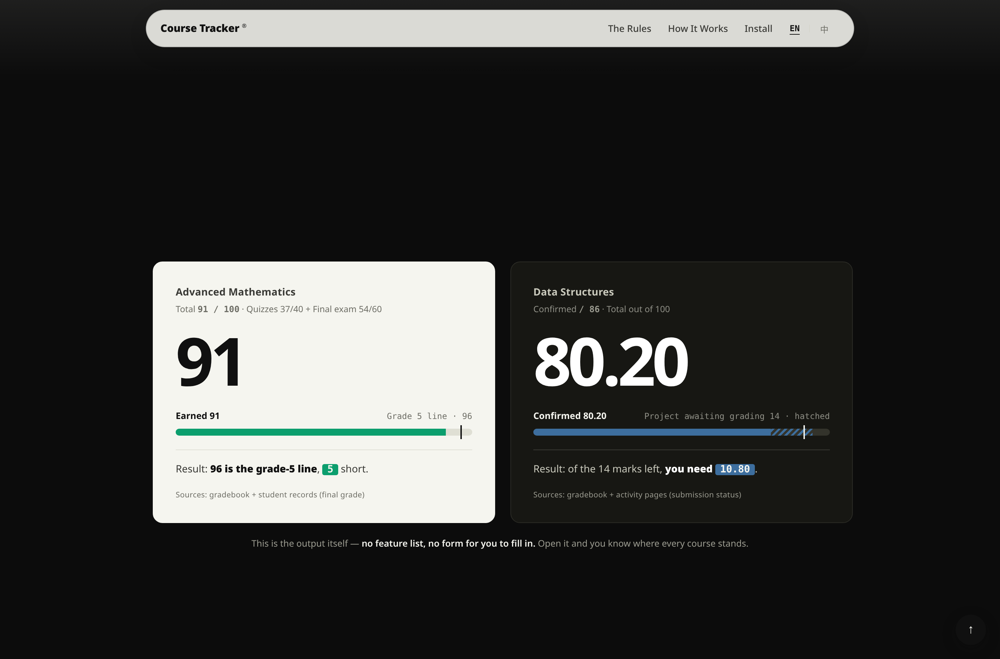
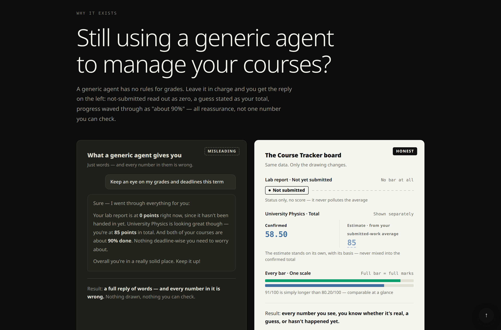
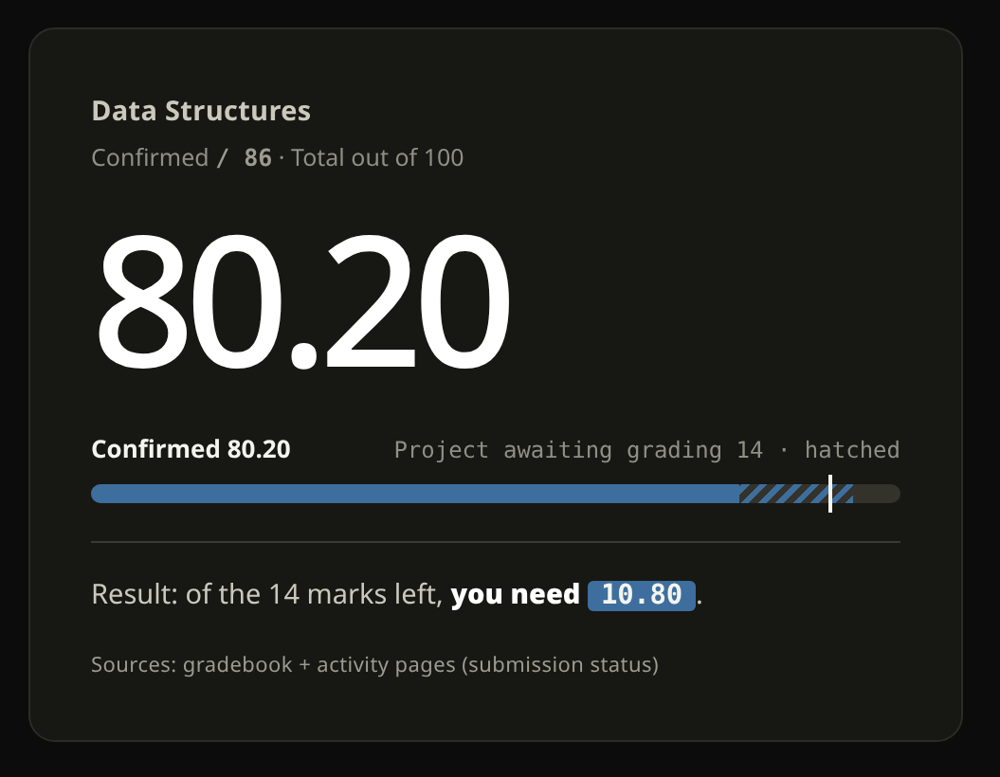
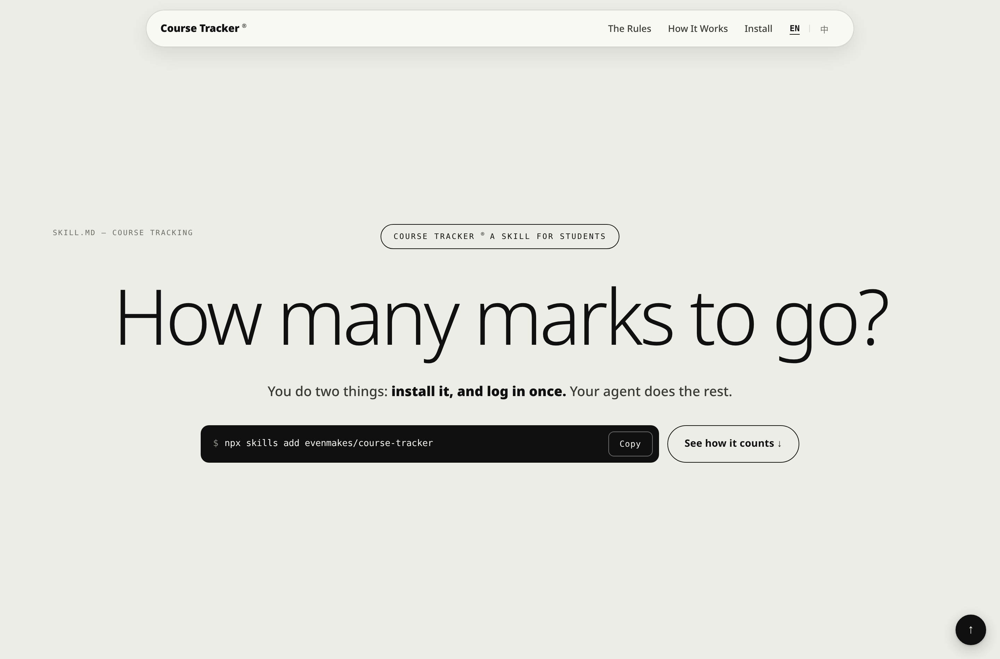

<p align="center">
  
</p>

<h1 align="center">Course Tracker</h1>

<p align="center"><strong>How many marks to go?</strong></p>

<p align="center">
  <a href="https://github.com/evenmakes/course-tracker/stargazers"></a>
  
  
</p>

A skill for AI agents that tracks a student's courses end to end — honestly.

The student does **two things**: installs this skill, and logs in once to their learning platform and student email. The agent does everything else. It discovers the enrolled courses on its own, extracts each course's graded components, full marks, grade bands and deadlines, builds a living dashboard, and keeps it current from the learning platform, school mail and course group chats.

No typing in your own grades. No spreadsheet. No "the app says 0/10" for work you simply haven't submitted yet.

## The comparison that started it

Ask a generic agent to track your courses and it will happily invent a tidy, wrong answer. Course Tracker is built around the opposite instinct: a score the platform hasn't published is *not* a zero, an estimate is *not* a fact, and a source it couldn't reach is *not* "no news".

<p align="center">
  
</p>

## What it does

- **Answers one question per course:** how many marks are still needed, on the work that remains, to reach your target grade — with a second, lower line for simply passing.
- **Ranks your remaining work** across all courses by marks per estimated hour, so "what do I do next?" always has an answer.
- **Watches deadlines like an adult:** reminders at 3 days, 1 day and on the morning itself — each one re-verified against the platform first, each carrying the meeting room or join link, and every reminder stops the moment the work is submitted.
- **Watches group work:** who in the team has delivered, who has gone silent, and what to chase before the meeting.
- **Generates a shareable report card** every time a new grade lands.

<p align="center">
  
</p>

## How it works

This is a protocol, not a scraper script. The skill teaches the agent a procedure, and the agent — which can already browse, read mail and talk to you — executes it inside *your* environment, with *your* logins. Nothing is uploaded anywhere.

### 1. First run: discovery, not data entry

On first run the agent asks for exactly one action: *log in to your learning platform and student email, once.* Then it:

1. Enumerates your enrolled courses from the platform itself — it never asks you to type course names, weights or deadlines.
2. For each course, builds a **mark model**: every graded component, its full marks, its weight, its deadline, and the grade bands (read from the course's own grading scale — Finnish 0–5, GPA, percentages; nothing is hard-coded).
3. Cross-checks three sources per component: the **gradebook** (computed totals), the **activity pages** (actual submission state), and the **student records system** (final registered grades for finished courses). Where sources disagree, the gradebook's computed figure wins, the conflict is flagged on the dashboard, and the two numbers are never averaged into a fiction.
4. Renders the dashboard and reports what it could *not* verify — as unverified, not as zero.

In the live test that validated this protocol, an agent with no prior knowledge of the student modelled four real courses — 40+ graded components — in about six minutes, with zero invented figures.

### 2. The honest state model

Every component lives in exactly one state, and each state has a fixed rendering. This table is the heart of the skill:

| State | Meaning | How it renders |
|---|---|---|
| `graded` | Score published by the teacher | Number + bar |
| `graded-unpublished` | Course finished, grade in the records system | Final grade, marked as registered |
| `submitted-awaiting` | Handed in, not yet graded | Hatched bar segment, "awaiting grading" — never a number |
| `in-progress` | Started, not submitted | Status pill, no bar |
| `not-submitted` | Deadline ahead, nothing handed in | Status pill, **no bar, never 0** |
| `not-yet-open` | Submission not yet open | Greyed, with opening date |
| `pass-fail` | No numeric score exists | Pass/Fail pill only |

Confirmed marks and estimates are stored as separate objects with separate rendering: an estimate is always smaller, always labelled, and always carries its basis ("teacher's historical curve", "your own stated expectation"). The two are never merged into one number.

### 3. The two lines

For each course the agent computes, over the marks still outstanding:

- **Safety line** — the minimum needed on remaining work to pass.
- **Target line** — the minimum needed on remaining work to reach your target grade.

Each line is flagged `open` (reachable), `locked` (already secured even with zeros on the rest), or `impossible` (unreachable even with full marks) — so bad news arrives early and precisely, e.g. *"96 is the grade-5 line. You are 5 short, and only the final exam remains."* A what-if mode recomputes both lines against any hypothetical score you give it.

### 4. The maintenance loop

The dashboard is one living page, refreshed from the platform, school mail and group chats. Every course card carries its own *last verified* timestamp. A login that has expired is reported as **"login expired — last verified Nov 19"**, never as "no new messages". At the end of term, finished courses are archived into a term record instead of quietly rotting on the board.

### 5. The dashboard design standard

The skill also specifies how the dashboard must look, because a tracker you can't read at a glance is a tracker you won't open:

- One card per course on a quiet off-white background; **one very large number per card** — the figure you'd act on.
- Every bar's full length equals that item's full marks; all bars in a figure share one scale; the target grade is a tick on the bar.
- State is carried by words (pills), never by colour alone; confirmed and estimate blocks are visually distinct.
- Light **and** dark themes, identical layout and content, switchable on the page.
- Deadlines first: a timeline (default: next 7 days) with countdowns sits above the course cards, because that's what you opened it for.

## Install

<p align="center">
  
</p>

```bash
npx skills add evenmakes/course-tracker
```

Then tell your agent:

> "Here is my learning platform, I am logged in. The rest is yours."

## FAQ

**Does it submit assignments or message my group for me?**
No. It reads, computes, reminds and drafts. Submitting, sending and sitting exams stay with you — deliberately.

**Where does my data live?**
In your own environment: the dashboard is generated where your agent runs (a hosted page in products that offer one, otherwise a local HTML file). The skill itself contains no accounts, no tracking, no phone-home.

**My school doesn't use Moodle.**
The protocol is platform-agnostic — it discovers the grading scale and components from whatever LMS it is pointed at. Moodle with the Finnish 0–5 scale is the route that has been live-tested end to end; Canvas and GPA scales are written into the protocol and are the next routes to verify with real users.

**Will it work before any grades exist?**
Yes — modelling the course structure, deadlines and the two lines is most of the value. Scores fill in as the term produces them.

## Status & roadmap

- ✅ Protocol v2, live-tested end to end on a real four-course term (University of Oulu, Moodle)
- ✅ First-run test by a zero-context agent: full mark model, zero fabricated figures
- 🔜 Canvas verification with a real user
- 🔜 30-second first-run demo video

Built from one real semester of tracking four courses at the University of Oulu — including the bruises. The dashboard in the screenshots is a fictional showcase; the numbers in the story are real.

If it saves you some panic, a star is the nicest way to say thanks: [github.com/evenmakes/course-tracker](https://github.com/evenmakes/course-tracker)

## 中文

你只做两件事：装上这个 skill，在学习平台登录一次。剩下的交给你的 agent——它自己找到你的课，把每门课的评分构成、满分、分数线和截止时间全部建模，算出离目标成绩还差多少分，按「分数 ÷ 预计耗时」排出先做哪件；盯着小组里谁交了谁没动；截止前 3 天、1 天、当天早晨三档提醒，每次提醒前先去平台核实，交了就停。

三条铁规：

- **未提交永远不显示成 0 分**——没交就是没交，不是零分。
- **确认分和预估分永远分开**，预估必须写明依据。
- **来源登不上就报「登录已失效」**，绝不报成「没有新消息」。

```bash
npx skills add evenmakes/course-tracker
```

---

Course Tracker — a skill polished out of one real term's bruises.
2026 · Even · Cloudberry Studio, Oulu · evenzhao00@outlook.com
